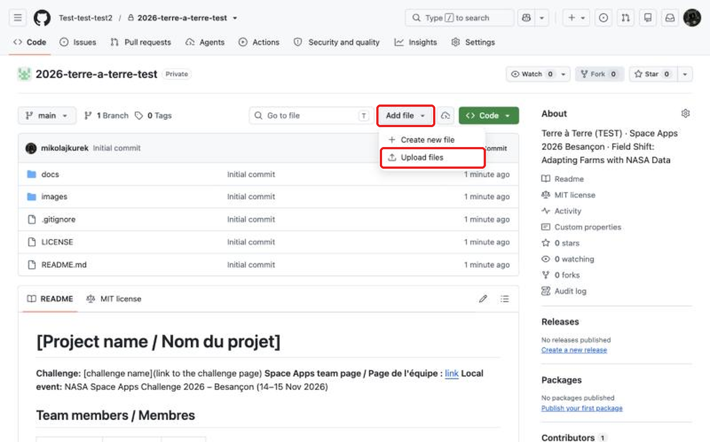
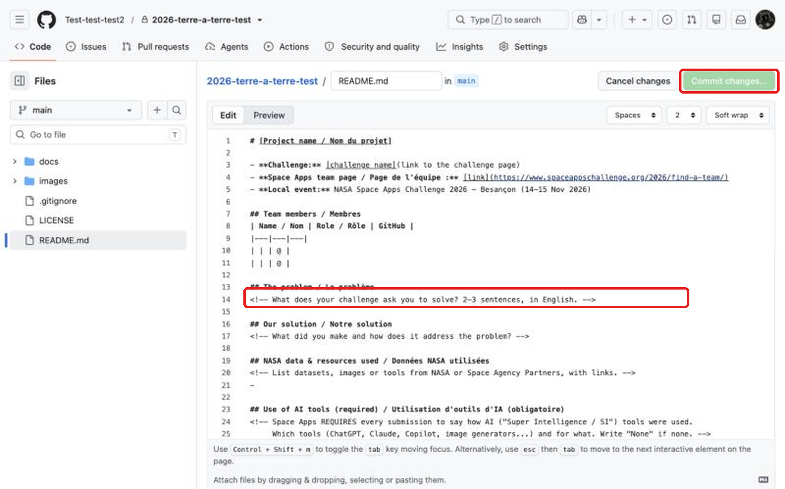
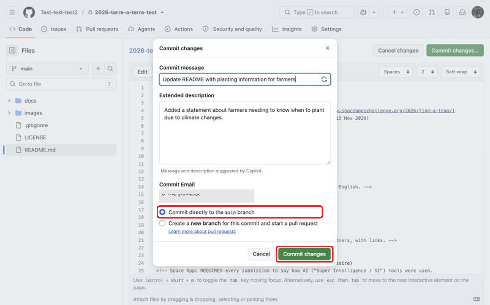

# 🚀 NASA Space Apps Challenge 2026 – Besançon

## Info / Infos pratiques
- **When / Quand :** Sat 14 Nov 09:00 → Sun 15 Nov 2026, **submission closes 23:59**
- **Where / Où :** Maison des Étudiants, 36A Av. de l'Observatoire, 25000 Besançon
- **Wi-Fi :** [network / password]
- **Organizers / Organisateurs (Astra FC, UMLP) :** [names + phone/WhatsApp]
- **Official event page :** https://www.spaceappschallenge.org/2026/local-events/besancon/

## Start here (5 min) / Commencez ici
1. **Create a free GitHub account** → https://github.com/signup (use an email you can open now)  
   **Créez un compte GitHub gratuit**
2. **Give your username to an organizer** (or fill the sign-up form) → you get an invitation  
   **Donnez votre nom d'utilisateur à un organisateur** → vous recevez une invitation
3. **Accept the invitation** → https://github.com/orgs/Test-test-test2/invitation (or the email "You've been invited…")  
   **Acceptez l'invitation**
4. **Open your team repo** in the table below and fill in `README.md`  
   **Ouvrez le dépôt de votre équipe** ci-dessous et remplissez `README.md`

## Never coded? Upload files / Jamais codé ? Déposer des fichiers
1. Open your team repo → **Add file → Upload files**

   
2. Drag your files in (max 25 MB each) / Glissez vos fichiers (25 Mo max chacun)
3. Click the green **Commit changes** button / Cliquez sur **Commit changes**

**Edit text / Modifier le texte :** open `README.md` → ✏️ (pencil) → write → **Commit changes…**

Keep **“Commit directly to the main branch”** → **Commit changes**. / Gardez « Commit directly… » → **Commit changes**.

Big files (videos…): upload to YouTube (unlisted) / Google Drive (“anyone with the link”) and paste the link in your README.  
Gros fichiers (vidéos…) : YouTube (non répertorié) / Google Drive, puis collez le lien dans votre README.

## Rules that matter / Règles importantes
- Max **6 people** per team, **one challenge** per team. / 6 personnes max, un seul défi.
- **No work before Sat 14 Nov 09:00** – your repo history shows when things were made. / Rien avant le début.
- You **must describe how you used AI tools** in your submission (section in the README). / Usage de l'IA obligatoire à décrire.
- Never upload passwords or API keys. / Jamais de mots de passe ni de clés API.

## Teams / Équipes
| Team | Challenge | Repo |
|---|---|---|
| Terre à Terre (TEST) | Field Shift: Adapting Farms with NASA Data | [2026-terre-a-terre-test](https://github.com/Test-test-test2/2026-terre-a-terre-test) |

## Deadline
**Sunday 15 Nov, 23:59** – README filled in + project submitted on your Space Apps team page (**Project** tab) with your repo link.  
**Dimanche 15 nov., 23h59** – README rempli + projet soumis sur spaceappschallenge.org avec le lien du dépôt.
